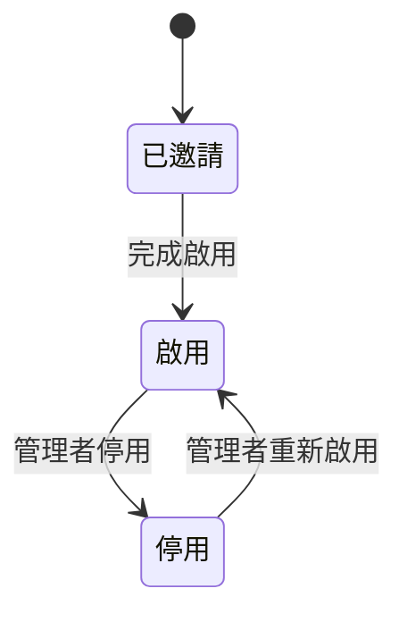
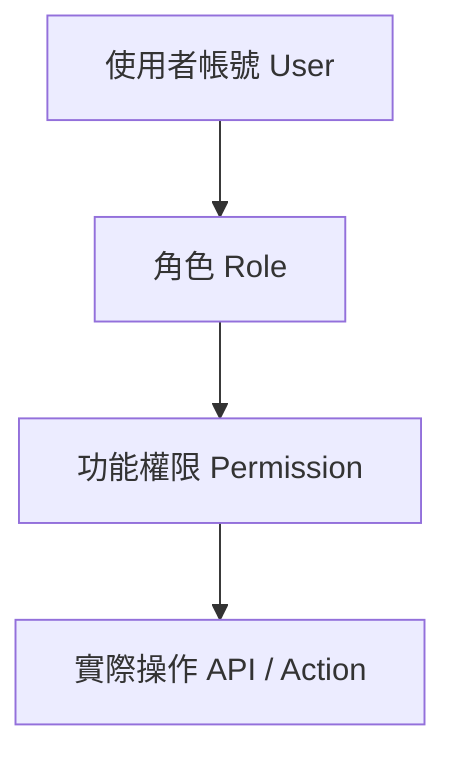
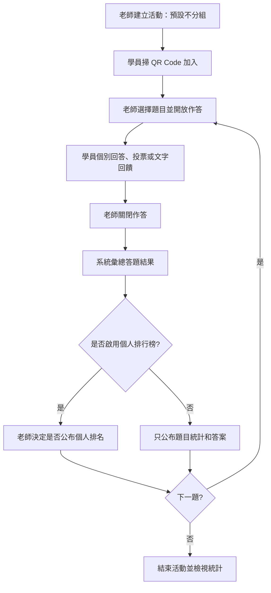
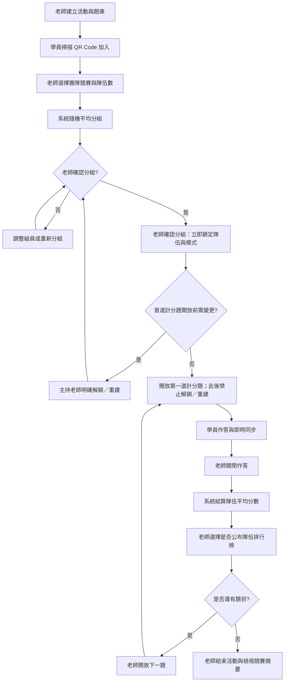
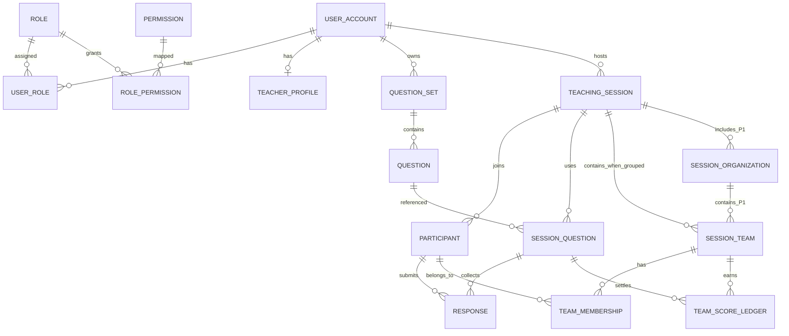

# 即時互動教學系統 — 系統功能規劃書 V1.2

> **文件類型：** 功能需求分析／MVP 規劃  
> **系統名稱：** Instructor-Led Interactive Learning System  
> **使用情境：** 企業與公益團體現場授課  
> **互動模式：** 講師主導（Instructor-Led）  
> **本版調整：** 每場活動可選擇「不分組」或「分組」；不分組為預設，分組後可選擇是否進行團隊競賽

## 一、系統定位與設計原則

本系統提供老師在企業或公益團體的**現場授課過程**中，讓學員透過手機參與問答、投票及討論，老師可以即時掌握結果並控制教學進度。

根據先前確立的 7 個產品假設，採用以下設計：

- **角色管理：** 正式系統帳號包含「系統管理者」與「老師」兩種角色。
- **老師管理：** 由系統管理者建立、維護、停用老師帳號與管理授權。
- **功能權限：** 透過 RBAC（Role-Based Access Control）管理角色與功能的對應。
- **學員參與：** 學員透過 QR Code 加入活動，不必註冊帳號。
- **互動模式：** 老師控制開始作答、停止作答、公布結果與下一題。
- **使用範圍：** 支援不同企業及公益團體的教學活動，但不將收費功能納入 MVP。
- **參與模式：** 每場活動由老師選擇**不分組（預設）**或**分組**。不分組可直接進行問答、投票、討論；分組可進行團隊練習或組間競賽。
- **競賽選項：** 不分組時可選擇無排行榜或個人排行榜；分組時可選擇無排行榜或團隊排行榜。跨企業／公益團體的組織間競賽列為下一階段擴充。
- **資料邊界：** 組織間競賽僅展示授權活動的彙總成績，不代表不同組織可以互相查閱原始學員資料。

### 產品的 7 個核心假設

| 編號 | 核心假設 | 教學現場的意義 |
|---|---|---|
| H01 | **即時互動能促進學員理解** | 講師透過問答與練習確認學員是否理解。 |
| H02 | **學員能快速加入活動** | 以手機掃描 QR Code，不需註冊帳號。 |
| H03 | **操作必須簡單且穩定** | 不干擾教學節奏，師生都能輕鬆操作。 |
| H04 | **即時回饋能協助講師調整教學** | 根據答題結果決定是否補充說明。 |
| H05 | **題庫能跨課程及組織重複使用** | 同一套教材可用於不同企業、公益團體和場次。 |
| H06 | **講師必須掌握活動控制權** | 老師決定開始、停止作答、公布結果及下一題。 |
| H07 | **適當的競爭與獎勵能促進參與** | 競賽不是必要條件：可在不分組的互動、個人排名、分組練習與團隊排名間選擇，適應不同授課情境。 |

## 二、完整系統功能架構

建議規劃為 **11 個功能模組**。

| 模組編號 | 功能模組 | 主要功能 | 優先級 |
|---|---|---|---|
| M01 | 帳號與登入管理 | 登入、登出、密碼及個人資料 | P0 |
| M02 | **角色管理** | 系統管理者、老師角色定義與維護 | P0 |
| M03 | **老師維護與管理** | 老師帳號 CRUD、啟停用、重設密碼、指派角色 | P0 |
| M04 | **角色與功能對應管理** | 功能清單、角色授權、權限檢查 | P0 |
| M05 | 題庫管理 | 建立、編輯、刪除、複製及分類題庫 | P0 |
| M06 | 教學活動管理 | 建立活動、選擇題庫、產生 QR Code、選擇是否分組 | P0 |
| M07 | 老師即時控制台 | 出題、開放作答、關閉作答、公布結果 | P0 |
| M08 | 學員互動管理 | 加入活動、作答、投票、文字回饋 | P0 |
| M09 | 即時統計與結果分析 | 答題分布、正確率、投影畫面、活動摘要 | P0 |
| M10 | 系統設定與稽核 | 系統參數、操作紀錄、活動監控 | P1 |
| M11 | **可選分組與團隊競賽** | 不分組／分組切換、隨機分組、調整組員、團隊計分與排行榜、組織競賽 | **不分組／分組 P0；組織間 P1** |

> P0：第一版必要功能；P1：建議第二階段完成。

---

## 三、M01～M04：帳號、角色與權限管理

這四個模組是整個系統的基礎。

### M01. 帳號與登入管理

| 功能 ID | 功能名稱 | 功能說明 |
|---|---|---|
| M01-01 | 使用者登入 | 系統管理者、老師透過帳號密碼登入 |
| M01-02 | 使用者登出 | 結束登入 Session |
| M01-03 | 修改密碼 | 使用者自行變更密碼 |
| M01-04 | 忘記密碼 | 透過驗證流程重設密碼 |
| M01-05 | 個人資料維護 | 查看、修改自己的姓名、聯絡方式等資料 |
| M01-06 | 登入狀態驗證 | 檢查登入憑證是否有效 |
| M01-07 | 密碼與登入安全 | 密碼雜湊、登入失敗限制、Session 逾時 |

#### M01 使用者需求與驗收規格

##### 1. 需求概覽與假設

- **功能目標：** 提供系統管理者與老師安全登入、管理本人密碼及基本資料，並確保已停用或登入憑證失效的帳號不能繼續存取受保護功能。
- **範圍：** 涵蓋 M01-01～M01-07；學員以活動憑證參與，不建立本模組的正式帳號。
- **前置條件／假設：** 正式帳號由系統管理者依 M03 建立或維護；帳號具唯一登入識別資訊及啟用狀態，並至少具備一個有效角色。未定義由使用者自行註冊，因此不納入本版。
- **登入識別：** 規劃書未指定帳號欄位；下列以「帳號」泛稱，實際採帳號名稱、Email 或其他識別值須確認。
- **忘記密碼：** 由已驗證且綁定帳號的聯絡方式執行重設；驗證媒介與有效期限待確認。

##### 2. 使用者故事

> **身為** 已啟用的系統管理者或老師，  
> **我希望** 能安全登入與登出、檢視及更新自己的個人資料、修改或重設密碼，並確認登入狀態有效，  
> **以便於** 使用符合本人角色權限的系統功能並保護帳號安全。

##### 3. 驗收條件

```gherkin
Feature: M01 帳號與登入管理

  Scenario: 啟用帳號以正確憑證登入
    Given 使用者帳號存在且狀態為啟用
    And 使用者提供正確帳號與密碼
    When 使用者提出登入要求
    Then 系統建立已驗證的登入 Session
    And 系統依帳號目前有效角色與權限提供存取
    And 系統不得將密碼或可還原的密碼內容回傳給用戶端

  Scenario: 不存在或停用的帳號不得登入
    Given 帳號不存在或帳號狀態為停用
    When 使用者提出登入要求
    Then 系統不建立登入 Session
    And 系統以不揭露帳號是否存在的方式回覆登入失敗

  Scenario: 密碼錯誤不得登入
    Given 使用者帳號存在且狀態為啟用
    When 使用者提供錯誤密碼
    Then 系統不建立登入 Session
    And 系統回覆一般化的登入失敗訊息
    And 系統依登入失敗限制政策累計失敗次數

  Scenario: 達登入失敗限制
    Given 使用者在設定的觀察期間內已達登入失敗限制
    When 使用者再次提出登入要求
    Then 系統依已核定的限制政策拒絕或延遲驗證
    And 系統不得建立登入 Session
    And 系統不得因限制機制洩露帳號存在狀態

  Scenario: 使用者正常登出
    Given 使用者持有有效登入 Session
    When 使用者登出
    Then 系統使該 Session 失效
    And 使用該 Session 憑證的後續受保護請求均須被拒絕

  Scenario: 修改密碼成功
    Given 使用者已登入且提供正確的目前密碼
    And 新密碼符合已核定的密碼政策
    When 使用者提交密碼變更
    Then 系統以安全的單向密碼雜湊方式儲存新密碼
    And 後續登入須使用新密碼
    And 系統不得以明文記錄或回傳新密碼

  Scenario: 修改密碼驗證失敗
    Given 使用者已登入
    When 使用者提供錯誤的目前密碼或不符合政策的新密碼
    Then 系統拒絕變更並說明可採取的修正方式
    And 原密碼仍有效

  Scenario: 忘記密碼重設成功
    Given 使用者可存取帳號已驗證的重設管道
    When 使用者完成核准的身分驗證並提交符合政策的新密碼
    Then 系統更新密碼並使重設憑證失效
    And 系統依安全政策使既有登入 Session 失效或要求重新登入
    And 系統不得在回覆中洩露密碼或重設憑證

  Scenario: 忘記密碼請求不揭露帳號是否存在
    Given 使用者提出忘記密碼要求
    When 該識別值不存在、停用或無可用驗證管道
    Then 系統回覆與一般受理情況一致的訊息
    And 不建立可用的密碼重設憑證

  Scenario: 個人資料查詢與更新
    Given 使用者已登入
    When 使用者查詢或更新自己的姓名及聯絡方式
    Then 系統只回傳或修改該登入帳號本人的允許欄位
    And 不允許透過提交其他帳號識別值修改他人資料或角色

  Scenario: 無效或逾時的登入憑證
    Given 登入 Session 已逾時、已登出或憑證無效
    When 用戶端請求受保護功能
    Then 系統拒絕該請求
    And 系統要求重新登入，且不執行受保護操作

  Scenario: Session 逾時
    Given 使用者登入後超過已核定的 Session 逾時條件
    When 使用者提出受保護請求
    Then 系統使該 Session 失效並拒絕請求

  Scenario: 帳號停用後使既有憑證失效
    Given 使用者原持有有效 Session
    When 系統管理者停用該帳號
    Then 該帳號不得再登入或呼叫受保護功能
    And 該帳號既有登入憑證依停用規則失效

  Scenario: 登入服務暫時不可用
    Given 登入服務或其必要依賴無法完成驗證
    When 使用者提出登入或密碼重設要求
    Then 系統不得將未完成驗證視為成功
    And 系統回覆可重試的服務錯誤，不洩露內部憑證或敏感資料
```

##### 4. 欄位規範與邊界檢查

- **帳號：** 必填且唯一；識別欄位、正規化方式、大小寫規則及長度上限待確認。登入失敗與忘記密碼回應須避免帳號枚舉。
- **密碼：** 登入及變更時必填；只儲存經現代、安全單向雜湊處理的密碼雜湊，不得明文儲存、記錄或回傳。最小／最大長度、複雜度、常見密碼阻擋及密碼歷史政策待確認。
- **姓名與聯絡方式：** 依 M03 帳號欄位定義共用格式；使用者只能維護本人獲允許的欄位。欄位必填性、長度、Email／電話格式待確認。
- **登入失敗限制：** 應定義計數範圍、觀察期間、限制方式、解除或恢復流程；具體閾值與鎖定時間待確認。錯誤回應不可區分帳號不存在、停用與密碼錯誤。
- **Session：** 登入成功才建立；登出、逾時、帳號停用及密碼重設後的失效範圍須一致且可驗證。閒置與絕對逾時值、是否支援多裝置登入及密碼變更後的保留策略待確認。
- **重設憑證：** 必須具備不可預測性、單次使用及到期失效特性；驗證管道、有效期限與發送頻率限制待確認。
- **權限邊界：** M01 僅維護本人資料與認證狀態；不得自行指派角色或提升權限。後端每次受保護請求均須驗證憑證及帳號有效狀態。
- **稽核與隱私：** 登入成功／失敗、登出、密碼變更／重設及帳號狀態相關安全事件應記錄必要資訊；不得記錄明文密碼、重設憑證或完整敏感資料。稽核欄位與保留期間由 M10 政策確認。
- **待釐清問題：** (1) 登入識別採何欄位？(2) 是否由管理者建立帳號並透過邀請啟用，抑或提供其他啟用流程？(3) 密碼長度與強度政策、登入失敗閾值及解除方式為何？(4) Session 閒置／絕對期限、多裝置及停用／重設時的撤銷策略為何？(5) 忘記密碼使用何種驗證管道及憑證有效期限？(6) 個人聯絡資料包含哪些欄位，哪些可由使用者自行修改？

### M02. 角色管理（Role Management）

系統預設兩種角色：

**系統管理者（SYSTEM_ADMIN）**

負責整個平台的帳號、老師、角色、權限與系統設定，不預設具有授課權限。

**老師（TEACHER）**

負責維護自己的題庫、建立教學活動、主持互動及查看自己的教學結果。

| 功能 ID | 功能名稱 | 功能說明 |
|---|---|---|
| M02-01 | 角色清單查詢 | 顯示角色代碼、名稱、說明及狀態 |
| M02-02 | 角色詳細資料 | 查看角色基本資料與對應功能 |
| M02-03 | 角色說明維護 | 修改角色名稱、描述等非系統識別欄位 |
| M02-04 | 角色狀態檢視 | 顯示角色是否為系統保留角色 |
| M02-05 | 使用者角色指派 | 一個帳號可被授予一個或多個角色 |

建議第一版將 `SYSTEM_ADMIN`、`TEACHER` 設為**固定系統角色，不允許刪除或修改角色代碼**，避免權限配置錯誤。

未來若需要增加「助教」、「企業管理者」，再擴充自訂角色管理功能。

### M03. 老師維護與管理（Teacher Management）

這是由系統管理者操作的老師帳號管理模組。

| 功能 ID | 功能名稱 | 功能說明 |
|---|---|---|
| M03-01 | 老師清單 | 顯示所有老師資料 |
| M03-02 | 老師搜尋 | 依姓名、帳號、Email、狀態搜尋 |
| M03-03 | 新增老師 | 建立老師帳號及基本資料 |
| M03-04 | 編輯老師 | 修改姓名、Email、聯絡資訊 |
| M03-05 | 檢視老師 | 查看老師基本資料及帳號狀態 |
| M03-06 | 啟用老師 | 允許老師登入系統 |
| M03-07 | 停用老師 | 停止老師存取系統 |
| M03-08 | 重設老師密碼 | 發起安全的密碼重設流程 |
| M03-09 | 指派角色 | 將老師帳號對應到 TEACHER 或其他授權角色 |
| M03-10 | 老師活動查詢 | 查看老師建立的教學活動紀錄 |
| M03-11 | 老師資料刪除 | 採邏輯刪除或停用，保留必要稽核紀錄 |

建議老師帳號採用以下狀態：



**重要業務規則：** 老師被停用不代表刪除其歷史題庫或教學紀錄。已建立的資料應依保留政策繼續保存，以免破壞活動報表。停用時應使既有登入憑證失效，並明確處理正在主持的活動。

### M04. 角色與功能對應管理（Role–Function Mapping）

這個模組決定「哪一種角色，可以操作哪一項功能」。

| 功能 ID | 功能名稱 | 功能說明 |
|---|---|---|
| M04-01 | 功能清單 | 列出系統所有可授權功能 |
| M04-02 | 功能分類 | 依帳號、老師、題庫、活動、報表等模組分類 |
| M04-03 | 角色功能查詢 | 檢視各角色目前擁有的功能 |
| M04-04 | 角色功能授權 | 勾選角色允許操作的功能 |
| M04-05 | 角色功能取消授權 | 移除角色既有的功能使用權 |
| M04-06 | 權限批次儲存 | 一次儲存角色的全部功能授權 |
| M04-07 | 功能存取檢查 | 後端 API 驗證使用者是否具備權限 |
| M04-08 | 權限變更紀錄 | 記錄誰在何時修改了角色授權 |
| M04-09 | 功能選單過濾 | 前端依權限顯示可操作的選單與按鈕 |

**建議採用三層權限設計：**



權限代碼範例：

- `TEACHER_READ`：查詢老師
- `TEACHER_CREATE`：新增老師
- `QUESTION_SET_CREATE`：建立題庫
- `SESSION_HOST`：主持活動
- `SESSION_CONTROL`：控制活動題目
- `REPORT_READ`：檢視報表
- `ROLE_PERMISSION_UPDATE`：修改角色授權
- `SESSION_GROUPING_CONFIGURE`：設定活動是否分組；TEAM 分組確認後提前鎖定，尚未鎖定的模式最晚於首道計分題開放時鎖定；TEAM 確認後僅可於計分前明確授權解鎖／重建，開放後不可解鎖或切換（M11-17）
- `TEAM_RANDOM_ASSIGN`：執行隨機分組
- `TEAM_MEMBER_UPDATE`：調整活動組員
- `TEAM_COMPETITION_CONTROL`：管理競賽設定及開始／結束
- `TEAM_SCORE_READ`：檢視團隊排行榜
- `ORGANIZATION_COMPETITION_MANAGE`：管理獲授權活動的組織間競賽（P1）

前端隱藏功能按鈕只是一種 UX 設計；真正的安全檢查必須在後端 API 執行。

#### 預設角色與功能權限矩陣

| 功能 | 系統管理者 | 老師 |
|---|:---:|:---:|
| 登入／個人資料維護 | ✓ | ✓ |
| 角色清單檢視 | ✓ | — |
| 角色功能權限維護 | ✓ | — |
| 新增／修改／停用老師 | ✓ | — |
| 重設老師密碼 | ✓ | — |
| 建立／編輯自己的題庫 | — | ✓ |
| 搜尋及檢視可用題庫 | — | ✓ |
| 建立教學活動 | — | ✓ |
| 產生活動 QR Code | — | ✓ |
| 控制教學活動 | — | ✓ |
| 管理活動參與者 | — | ✓ |
| 設定活動分組／不分組 | — | ✓ |
| 隨機分組／調整組員（分組模式） | — | ✓ |
| 個人排行榜／團隊排行榜控制 | — | ✓ |
| 檢視自己活動的個人／團隊排行榜 | — | ✓ |
| 管理自己活動的組織間競賽（P1） | — | ✓ |
| 檢視自己的教學報表 | — | ✓ |
| 全平台活動紀錄查詢 | ✓ | — |
| 系統設定與稽核紀錄 | ✓ | — |

這是建議的**最小權限預設值**。若系統管理者也需要主持教學，可額外指派 `TEACHER` 角色，不必讓所有管理者自動擁有老師功能。

另外，權限管理必須防止意外撤銷最後一位有效系統管理者的必要權限。

---

## 四、M05～M09：核心教學功能

### M05. 題庫管理

| 功能 ID | 功能名稱 | 說明 |
|---|---|---|
| M05-01 | 建立題庫 | 設定題庫名稱、主題、描述 |
| M05-02 | 維護題目 | 新增、修改、刪除題目及答案 |
| M05-03 | 題型管理 | 單選、多選、投票、開放式文字 |
| M05-04 | 題庫複製 | 複製現有題庫供其他課程使用 |
| M05-05 | 題庫分類 | 依課程主題或標籤分類 |
| M05-06 | 題庫查詢 | 搜尋與檢視自己的題庫 |

### M06. 教學活動管理

| 功能 ID | 功能名稱 | 說明 |
|---|---|---|
| M06-01 | 建立教學活動 | 設定活動名稱、日期、主辦單位 |
| M06-02 | 選擇題庫 | 指定活動使用的題目 |
| M06-03 | 產生加入資訊 | Game PIN、QR Code、活動連結 |
| M06-04 | 活動設定 | 暱稱、匿名、計分、排行榜選項 |
| M06-05 | 活動清單 | 查詢尚未開始、進行中及歷史活動 |
| M06-06 | 結束活動 | 結束 Session，保留活動結果 |
| M06-07 | 活動參與模式 | 老師選擇「不分組」或「分組」，**預設不分組** |
| M06-08 | 排名與計分設定 | 不分組可選「不排行／個人排名」；分組可選「不排行／團隊排名」 |
| M06-09 | 分組參數（條件顯示） | 只有啟用分組時才出現隊伍數、自訂隊名與分組方式等設定 |
| M06-10 | 模式異動檢查 | TEAM 分組確認即提前鎖定隊伍及模式；確認前及 INDIVIDUAL 模式可於首道計分題開放前調整。TEAM 確認後僅可計分前明確解鎖／重建；首道計分題開放時尚未鎖定的模式一併鎖定，之後不得解鎖／重建或切換 |

### M07. 老師即時控制台

| 功能 ID | 功能名稱 | 說明 |
|---|---|---|
| M07-01 | 開始活動 | 啟動教學 Session |
| M07-02 | 選擇題目 | 選擇準備出給學員的題目 |
| M07-03 | 開放作答 | 發送題目並允許學員回答 |
| M07-04 | 停止作答 | 結束目前題目的答題階段 |
| M07-05 | 公布統計 | 顯示各選項的作答比例 |
| M07-06 | 公布正確答案 | 由老師決定何時揭曉 |
| M07-07 | 下一題 | 切換至其他題目 |
| M07-08 | 查看人數 | 即時掌握在線及已作答人數 |
| M07-09 | 控制投影畫面 | 選擇投影題目、統計或答案 |
| M07-10 | 隨機分組控制 | **僅分組模式**顯示；指定隊伍數並一鍵隨機分配學員 |
| M07-11 | 隊伍調整與確認 | **僅分組模式**顯示；老師確認隊伍時立即鎖定；確認後計分前僅可經明確解鎖／重建流程調整，計分題開放後不可解鎖／重建。其他模式最晚於第一道計分題開放時鎖定 |
| M07-12 | 排行榜控制 | 老師決定何時公布個人或團隊排行；未啟用排行榜則不顯示 |
| M07-13 | 模式狀態提示 | 清楚顯示「不分組／分組」及目前排名設定，避免老師誤用控制功能 |

### M08. 學員互動管理

| 功能 ID | 功能名稱 | 說明 |
|---|---|---|
| M08-01 | 加入活動 | 透過 PIN、連結或 QR Code |
| M08-02 | 設定暱稱 | 由學員輸入或系統分配 |
| M08-03 | 等候活動 | 等待老師啟動題目 |
| M08-04 | 選擇題作答 | 單選／多選 |
| M08-05 | 意見投票 | 提交沒有標準答案的意見 |
| M08-06 | 文字回饋 | 提交文字答案或心得 |
| M08-07 | 接收結果 | 查看老師公布的結果 |
| M08-08 | 重新連線 | 短暫斷線後恢復目前活動狀態 |
| M08-09 | 檢視所屬隊伍 | **只有分組模式**才顯示隊伍名稱及競賽狀態 |
| M08-10 | 接收團隊結果 | **只有分組且啟用團隊排行時**，在老師公布後檢視排名 |
| M08-11 | 不分組個人互動 | 不建立隊伍、不要求分組；直接作答、投票與提交意見 |
| M08-12 | 接收個人結果 | 不分組且啟用個人排行時，依老師公布設定顯示個人分數或排名 |

學員是活動的臨時參與者（Participant），**不必納入 M02 的正式帳號角色管理**。其權限由活動憑證與 Session 狀態控制。

### M09. 即時統計與結果分析

| 功能 ID | 功能名稱 | 說明 |
|---|---|---|
| M09-01 | 即時作答人數 | 顯示已作答／未作答人數 |
| M09-02 | 答案分布 | 統計各選項人數及百分比 |
| M09-03 | 正確率統計 | 計算知識測驗的答題正確率 |
| M09-04 | 投影統計 | 提供適合大螢幕的結果畫面 |
| M09-05 | 活動摘要 | 整理各題與活動整體統計 |
| M09-06 | 報表查詢 | 老師查詢自己的活動成果 |
| M09-07 | 報表匯出 | 匯出 CSV 或 Excel，列為 P1 |
| M09-08 | 團隊得分 | **分組模式且啟用團隊計分時**，依明確規則累積各隊分數 |
| M09-09 | 隊伍排行榜 | **僅團隊排名模式**生成，由老師控制公布 |
| M09-10 | 組織排行榜（P1） | 依相同活動題目及計分規則比較參與組織 |
| M09-11 | 個人得分 | **不分組且啟用個人計分時**，依每題結果累積個人分數 |
| M09-12 | 個人排行榜 | **僅個人排名模式**生成，由老師控制公布 |
| M09-13 | 無排名活動摘要 | 無論是否分組，均提供作答人數、各題答案分布及正確率 |

## 五、M10～M11：系統設定、可選分組與競賽

| 功能 ID | 功能名稱 | 說明 |
|---|---|---|
| M10-01 | 基本參數設定 | 活動預設值、Session 逾時等 |
| M10-02 | 系統使用紀錄 | 查詢使用者登入、登出等事件 |
| M10-03 | 權限異動紀錄 | 記錄角色功能授權的異動 |
| M10-04 | 老師帳號異動紀錄 | 記錄建立、修改、停用操作 |
| M10-05 | 活動監控 | 查看進行中的活動及連線狀態 |

### M11. 可選分組與團隊競賽（Optional Grouping & Team Competition）

**目的：** 提供老師兩種授課模式：**不分組**時直接進行全班互動，**分組**時可隨機組隊、合作練習或進行組間競賽。是否顯示排行榜為另一項選擇；若參加者來自不同企業或公益團體，還可於後續版本擴充授權活動的**組織間競賽**。

> **名詞界定：**「組／隊伍（Team）」是單一教學活動內的合作／競賽單位，**只有啟用分組時才存在**；「組織（Organization）」是公司、協會或公益團體，可參與同一場授權活動，但不可與 Team 混為同一資料物件。

#### M11-1. 功能清單

| 功能 ID | 功能名稱 | 功能說明 | 優先級 |
|---|---|---|---|
| M11-01 | 設定是否分組 | 由老師選擇 `INDIVIDUAL`（不分組，預設）或 `TEAM`（分組） | P0 |
| M11-02 | 設定隊伍數 | **僅分組模式**適用；依參加人數設定至少 2 組且不超過可分配人數 | P0 |
| M11-03 | 一鍵隨機分組 | 將已加入的有效學員打散後儘量平均分配 | P0 |
| M11-04 | 自訂隊名 | 老師可以命名各隊，系統也可產生預設名稱 | P0 |
| M11-05 | 檢視分組結果 | 老師查看隊伍名單，學員查看所屬隊伍 | P0 |
| M11-06 | 手動調整組員 | TEAM 分組確認前可調整；確認後僅可在首道計分題開放前依明確解鎖／重建流程調整，計分開始後禁止修改既有組員配置 | P0 |
| M11-07 | 鎖定分組 | 老師確認 TEAM 分組時立即鎖定當前隊伍與成員安排及活動模式；第一道計分題開放時，尚未鎖定的活動模式亦須鎖定。TEAM 確認後、計分題開放前僅可依明確解鎖／重建流程解除；開放後禁止解鎖／重建至活動結束 | P0 |
| M11-08 | 遲到加入者處理 | 競賽進行中可依設定指派至人數最少的隊伍，僅參與後續題目 | P0 |
| M11-09 | 團隊自動計分 | 依知識測驗的作答結果計算標準化團隊得分 | P0 |
| M11-10 | 隊伍排行榜 | 僅分組並啟用 `TEAM` 排行時提供隊伍得分與並列名次 | P0 |
| M11-11 | 老師控制公布 | 老師決定是否及何時顯示適用的個人／團隊排行榜 | P0 |
| M11-12 | 組織設定 | 同場活動建立參與組織名稱或代碼，並核對學員隸屬 | P1 |
| M11-13 | 組織內隨機分組 | 在各組織內分別隨機組隊，避免未經授權跨組織混組 | P1 |
| M11-14 | 組織間排行榜 | 使用相同題目及一致計分規則，比較組織的標準化成績 | P1 |
| M11-15 | 競賽摘要 | 檢視各隊及各組織的總得分、答題表現和有效人數 | P1 |
| M11-16 | 不分組活動 | 不建立隊伍、不產生分組流程；全班直接問答、投票或文字互動 | P0 |
| M11-17 | 分組模式異動限制 | TEAM 分組確認即提前鎖定隊伍與模式；TEAM 確認前及 INDIVIDUAL 模式可於第一道計分題開放前變更。計分題開放時任何尚未鎖定的模式均鎖定；開放後不得解鎖／重建或切換，需另開活動，以保護歷史分數一致性 | P0 |
| M11-18 | 條件式畫面與 API | 分組功能只在 `TEAM` 模式啟用，後端拒絕不分組活動的分組操作 | P0 |
| M11-19 | 個人排行榜選項 | 不分組時可選擇不排行或個人排行榜，僅在老師公布後顯示 | P0 |

#### M11-2. 活動模式與競賽選項

**兩項獨立設定：** `grouping_mode` 決定學員是否被編隊；`leaderboard_mode` 決定是否展示競賽排名。**預設為不分組＋不排名。**

| 分組模式 | 排行榜模式 | 功能表現 | MVP |
|---|---|---|---|
| 不分組 `INDIVIDUAL` | 無 `NONE` | 個人作答、投票及意見回饋，僅展示彙總統計 | ✓ 預設 |
| 不分組 `INDIVIDUAL` | 個人 `INDIVIDUAL` | 個人分數與個人排行榜，僅在老師公布後展示 | ✓ 可選 |
| 分組 `TEAM` | 無 `NONE` | 一鍵分組，按組合作與答題，**不顯示排行榜** | ✓ 可選 |
| 分組 `TEAM` | 團隊 `TEAM` | 一鍵分組、團隊平均計分、組間排行榜 | ✓ 可選 |
| 不分組 | 團隊 `TEAM` | 不允許：無隊伍不可產生團隊排行 | ✗ |
| 分組 | 個人 `INDIVIDUAL` | 第一版不提供此組合，以免混淆個人與團隊競賽 | ✗ |

**組織間競賽（P1）：** 可在獲授權的共同活動中對組織彙總成績進行比較，是否分組仍可獨立設定；須有明確的組織歸屬與相同計分條件。跨不同日期場次的大型聯賽不納入本版。

**操作時機：** 老師可在建立活動時預先選擇模式；TEAM 隊伍安排由老師確認時即鎖定隊伍及當前分組／排行榜模式。確認後至**第一道計分題開放前**，如需變更，必須由主持老師明確執行解鎖／重建流程；解鎖前須確認尚未開始計分，並原子更新隊伍與成員關係。對尚未確認 TEAM 分組或 INDIVIDUAL 活動，模式可於第一道計分題開放前變更；第一道計分題一旦開放，任何尚未鎖定的模式亦須原子鎖定，所有模式與隊伍安排固定至活動結束，禁止解鎖／重建或切換；如需變更須另開活動，且不得追溯改寫已結算分數或題目資格快照。活動開始、分組確認及第一道計分題開放為不同事件。純投票／文字活動也不必分組。

#### M11-2A. 不分組流程（預設）



#### M11-3. 組隊與公平計分設計（僅分組模式）

1. **平均隨機分配：** 首次分組對全部有效學員做隨機洗牌，再依隊伍循環分配；初始每隊人數差最多為 1。
2. **唯一隊伍：** 同場競賽每位學員最多屬於一個有效隊伍，不得重複計分。
3. **分組鎖定：** 老師確認 TEAM 分組時即鎖定當前隊伍與成員安排及活動模式；尚未確認的 TEAM 模式及 INDIVIDUAL 模式最晚於第一道計分題開放時鎖定。TEAM 分組確認後、計分題開放前，只有主持老師可依明確授權流程解鎖／重建；解鎖後重新確認即再次鎖定。第一道計分題開放後，禁止解鎖、重新分組、移動既有組員或切換模式；須另開活動。不得追溯修改已結算題目、分數或題目資格快照。
4. **遲到與斷線：** 遲到者可依規則指派至目前人數最少隊伍，作為不改動既有隊員配置的新增成員，只參與加入後尚未開放且具資格的題目；不得改寫已確認的既有成員安排、已開放題目的資格快照或已結算分數。斷線重連不得建立第二個參賽者身分。
5. **基本題目得分：** 正確答案 100 分，錯誤或未作答 0 分。投票與自由文字回饋預設不納入分數。
6. **人數標準化：** 每題的隊伍分數 = 該題開始時具有作答資格的隊員所得分數總和 ÷ 該題隊員人數。每場隊伍總分為各計分題的隊伍分數加總。這避免大隊伍單純因人數多而占優勢。
7. **有效人數快照：** 每題開放作答時，固定該題各隊有作答資格的名單。未作答者計 0 分，不能靠中途離隊提高平均分；新加入者不影響已開放題目的分母。
8. **並列名次：** 若總分相同，顯示相同名次，不額外引入未公告的速度加分。
9. **公平組織競賽：** 同一組織間競賽活動使用一致題庫、題目順序、答題時間及基本配分；組織分數也依每題實際有資格人數做標準化，再加總。不可直接比較不同難度活動的原始積分。
10. **資料隱私：** 組織排行榜僅公開名稱或代碼及彙總成績；原始作答、暱稱與個資不得因跨組織競賽而互相開放查詢。

#### M11-4. 老師主導的分組競賽流程（分組時適用）



#### M11-5. 分組／不分組驗收情境（BDD 草案）

```gherkin
Feature: 講師主導的可選分組與競賽

  Scenario: 建立活動預設不分組且不排名
    Given 老師正在建立一場教學活動
    When 老師未主動開啟分組或排行榜
    Then 活動應使用 INDIVIDUAL 分組模式與 NONE 排行模式
    And 系統不應建立 SESSION_TEAM 或 TEAM_MEMBERSHIP
    And 學員可以直接進行個人問答、投票及文字回饋

  Scenario: 不分組時老師只公布全班統計
    Given 活動使用 INDIVIDUAL 模式與 NONE 排行模式
    And 10 位學員已加入活動
    When 老師開放題目且 8 位學員提交答案
    And 老師關閉作答並公布統計
    Then 系統應顯示 8 位已作答與各選項分布
    And 系統不應顯示隊伍、團隊分數或排行榜

  Scenario: 不分組可選擇個人排行榜
    Given 活動尚未開始第一道計分題
    And 活動使用 INDIVIDUAL 模式
    When 老師設定排行榜模式為 INDIVIDUAL
    Then 系統應允許個人計分
    And 個人排行榜應在老師主動公布後才顯示

  Scenario: 不分組活動不得呼叫隨機分組
    Given 活動使用 INDIVIDUAL 模式
    When 學員或老師呼叫隨機分組 API 而沒有先更改活動模式
    Then 系統應拒絕該要求

  Scenario: 老師確認分組時立即鎖定隊伍及模式
    Given 活動使用 TEAM 模式且老師已完成隊伍安排
    When 老師確認分組
    Then 系統應立即鎖定隊伍成員安排及當前分組／排行榜模式
    And 未經明確解鎖／重建不得調整既有組員或變更模式

  Scenario: 首道計分題開放時鎖定尚未確認的模式
    Given 活動使用 INDIVIDUAL 模式或 TEAM 分組尚未確認
    And 尚未開放任何計分題
    When 主持老師開放第一道計分題
    Then 系統應原子鎖定當前分組／排行榜模式至活動結束
    And 後續不得解鎖／重建或切換模式

  Scenario: 首道計分題開放前可明確解鎖並重建
    Given TEAM 分組已確認且尚未開放第一道計分題
    When 主持老師依授權流程明確解鎖並重建分組
    Then 系統應原子保存新的隊伍／成員安排及相容模式
    And 新安排再次確認後立即鎖定
    And 不得改寫任何已結算分數或歷史題目資格快照

  Scenario: 計分開始後不得解鎖、重建或切換模式
    Given 活動已開放第一道計分題
    When 老師嘗試解鎖／重建分組或切換 grouping_mode／leaderboard_mode
    Then 系統應拒絕操作並要求如需變更另開活動
    And 既有作答、題目資格快照及得分資料應保持不變


  Scenario: 11 位學員平均分成 3 隊
    Given 活動已加入 11 位有效學員
    And 老師設定隊伍數為 3
    When 老師執行隨機分組
    Then 系統應建立 3 個隊伍
    And 各隊人數應為 4、4、3 人
    And 每位學員應恰好隸屬一個隊伍

  Scenario: 不同人數隊伍採平均計分
    Given 第一題的 A 隊有 2 位有效參賽者
    And 第一題的 B 隊有 3 位有效參賽者
    When A 隊有 2 位學員答對
    And B 隊有 2 位學員答對
    And 老師關閉作答
    Then A 隊本題應取得 100 分
    And B 隊本題應取得約 66.67 分

  Scenario: 競賽開始後有遲到學員加入
    Given 第一題已結算且隊伍已鎖定
    When 一位新學員加入並由系統指派隊伍
    Then 該學員不得影響第一題的有效人數及分數
    And 指派遲到者不得改寫既有隊員安排或任何已開放題目的資格快照
    And 該學員可自下一道尚未開放且具資格的題目參與計分

  Scenario: 老師才可以公布排行榜
    Given 一道計分題已完成結算
    When 學員嘗試呼叫公布排行榜功能
    Then 系統應拒絕該操作
    When 主持老師選擇公布排行榜
    Then 投影畫面與獲授權學員畫面才顯示排名
```

---

## 六、建議的核心資料模型

為配合三個指定的管理功能，後端至少需要以下資料物件。



其中：

- `USER_ACCOUNT`：正式帳號。
- `ROLE`：系統管理者、老師。
- `PERMISSION`：可操作功能，例如建立題庫或主持活動。
- `USER_ROLE`：使用者與角色的多對多關係。
- `ROLE_PERMISSION`：角色與功能權限的多對多關係。
- `TEACHER_PROFILE`：老師基本資料。
- `TEACHING_SESSION`：每一場現場教學活動，包含 `grouping_mode`（`INDIVIDUAL`／`TEAM`，預設 `INDIVIDUAL`）及 `leaderboard_mode`（`NONE`／`INDIVIDUAL`／`TEAM`，預設 `NONE`）。
- `PARTICIPANT`：單場活動的學員身分。
- `RESPONSE`：學員提交的答案或意見。
- `SESSION_TEAM`：**僅在分組模式**才建立；記錄單一活動的隊伍（組）代碼與名稱。
- `TEAM_MEMBERSHIP`：活動學員與隊伍的對應及生效時間。
- `TEAM_SCORE_LEDGER`：**僅在團隊計分模式**才建立；記錄每道計分題的隊伍結算結果，避免重複計分。個人分數可由已儲存的答題結果依計分規則計算，或另行建立個人分數彙總。
- `SESSION_ORGANIZATION`（P1）：同一活動內的參賽組織及顯示名稱；不等同完整多租戶管理。

建議保留 `SESSION_QUESTION` 作為場次題目快照，避免老師在活動結束後修改原始題庫，導致歷史結果與當時題目不一致。

**資料完整性規則：**

- 當 `grouping_mode=INDIVIDUAL` 時，不建立 `SESSION_TEAM`、`TEAM_MEMBERSHIP`、`TEAM_SCORE_LEDGER`；活動仍可有 `PARTICIPANT`、`RESPONSE` 及題目統計。
- 當 `grouping_mode=TEAM` 時，才允許新增隊伍與隊員關聯；同一活動內一位有效學員最多一個有效隊伍。
- 每道題目每隊僅可有一筆已結算的 `TEAM_SCORE_LEDGER`；避免重送重複計分。
- 資料庫／API 必須檢查 `grouping_mode` 與 `leaderboard_mode` 相容性，不只依前端畫面控制。
- 後端應依 Session 所屬老師進行資源層級授權，而不只驗證角色。

## 七、最重要的 Business Rules

| 規則 ID | 業務規則 |
|---|---|
| BR-001 | 只有系統管理者可以維護老師帳號與角色功能授權。 |
| BR-002 | 老師只可維護自己擁有的題庫及教學活動。 |
| BR-003 | 一個帳號可以被指派多個角色，但不得自行提升權限。 |
| BR-004 | 已停用的帳號不得繼續存取受保護功能。 |
| BR-005 | 角色功能授權須同時套用於前端操作及後端 API。 |
| BR-006 | 系統必須記錄角色授權及老師帳號狀態的異動。 |
| BR-007 | 只有活動主持老師可以控制題目狀態。 |
| BR-008 | 題目必須處於開放作答狀態，才允許提交答案。 |
| BR-009 | 學員不需正式帳號，但每場活動都必須能唯一區分參與者。 |
| BR-010 | 公布結果與公布正確答案應由老師分別控制。 |
| BR-011 | 只有活動主持老師可切換參與模式、建立分組、修改組員及公布排行榜。 |
| BR-012 | **分組模式**隨機分組須至少 2 隊，隊伍數不可超過當時可分配的有效學員數。 |
| BR-013 | 首次隨機分組應儘量平均；若人數無法整除，每隊人數差最多為 1。 |
| BR-014 | 同一活動中，一名有效學員不得同時屬於多個有效競賽隊伍。 |
| BR-015 | 老師確認 TEAM 分組時即鎖定隊伍與模式；尚未確認的 TEAM 模式及 INDIVIDUAL 模式最晚於第一道計分題開放時鎖定。TEAM 確認後、計分題開放前僅可由主持老師依明確授權流程解鎖／重建，重新確認後再次鎖定。計分開始後禁止解鎖／重建或切換模式；不得追溯更動已結算分數及題目資格快照。 |
| BR-016 | 遲到加入者只能從尚未開放的下一道計分題開始得分。 |
| BR-017 | 基本計分題答對 100 分，答錯或未作答 0 分；投票及自由文字預設不計分。 |
| BR-018 | 每題隊伍得分按該題開始時有作答資格的隊員人數平均，總分加總各計分題。 |
| BR-019 | 啟用個人或團隊排行時，並列總分應顯示並列名次，且排行榜僅能由老師主動公布。 |
| BR-020 | 系統不得因斷線重連或答案重送而重複建立學員身分或累積分數。 |
| BR-021 | 組織間競賽只允許獲授權的共同活動共享組織名稱及彙總成績，不得跨組織洩漏明細。 |
| BR-022 | 組織競賽使用相同題目與計分條件；不同活動間的累積聯賽不在 V1.2 範圍。 |
| BR-023 | 新建活動的 `grouping_mode` 預設為 `INDIVIDUAL`，`leaderboard_mode` 預設為 `NONE`。 |
| BR-024 | 不分組時，學員可以直接參與問答、投票及文字回饋，不得強制建立隊伍。 |
| BR-025 | 只有 `TEAM` 分組模式允許使用建立隊伍、隨機分組及調整組員功能。 |
| BR-026 | `INDIVIDUAL` 模式僅可使用 `NONE` 或 `INDIVIDUAL` 排行；`TEAM` 模式僅可使用 `NONE` 或 `TEAM` 排行。 |
| BR-027 | 老師確認 TEAM 分組後即鎖定是否分組及排行榜模式；尚未確認的 TEAM 模式及 INDIVIDUAL 模式僅可於第一道計分題開放前變更，開放時即鎖定。確認後如需在計分前變更，僅可透過明確解鎖／重建流程；第一道計分題開放後須保持模式一致至活動結束，不得解鎖／重建，如需變更須另開活動。 |
| BR-028 | 不分組時系統不應建立團隊關聯或團隊結算紀錄，也不應顯示團隊排行榜。 |
| BR-029 | 沒有啟用排行榜的活動仍必須提供講師可用的作答人數、答案分布與正確率。 |
| BR-030 | 個人與團隊排行榜均由老師決定是否公布，不應自動對學員公開。 |

## 八、建議的開發順序

### 第一階段：建立平台管理基礎

M01 帳號登入 → M02 角色管理 → M03 老師管理 → M04 角色與功能對應管理。

**完成標準：** 系統管理者可建立老師帳號，並管控老師能使用的功能。

### 第二階段：完成現場互動核心流程

M05 題庫管理 → M06 活動建立（預設不分組）→ M07 老師控制台 → M08 學員互動 → M09 個人作答統計 → **M11 可選分組、隨機分組與組間競賽** → M09 個人／團隊排行榜。

**完成標準：** 可獨立完成**不分組**的現場問答、投票及結果統計；若老師選擇分組，也能完成隨機分隊、團隊計分與組間排名。

### 第三階段：學習分析與營運管理

M09 進階統計與報表 → M10 系統設定與稽核 → **M11 組織間競賽（P1）**，並完成併發及斷線恢復測試。

**完成標準：** 老師可即時判斷學員理解狀況，系統管理者可掌握平台運作情形。

---

## 九、整體建議

第一版採用「**兩種正式角色＋訪客學員＋可設定功能權限＋每場活動可選擇不分組或分組**」的設計。**不分組是預設，分組與排行榜都是講師可選功能**；這能同時服務企業問答、公益投票及團隊競賽情境，而不增加不必要的操作。

同時，從一開始就在資料中保留活動所屬公司／公益團體的識別資訊。**組織間競賽**先限定於獲授權的同場教學活動，只比較經標準化的組織彙總成績；若未來各組織要自行管理老師或跨活動競賽，再擴充正式組織管理與多租戶資料隔離機制。

這份規劃可作為後續撰寫 **FRS（Functional Requirements Specification）、Use Case、ERD 與 BDD 驗收案例**的基礎。


## 十、版本異動紀錄

| 版本 | 異動說明 |
|---|---|
| V1.0 | 建立 M01～M10 功能、角色權限、核心資料模型及業務規則。 |
| V1.1 | 新增 **M11 隨機分組與團隊競賽**；整合 M04、M06～M09 的操作權限與畫面功能；擴充資料模型、BR-011～BR-022、BDD 驗收情境；區分 **組間競賽（P0）** 與 **組織間競賽（P1）**。 |
| **V1.2** | **新增每場活動可選「不分組／分組」**，預設不分組；分離分組與排行榜設定；擴充個人排名、介面條件顯示、資料約束與 BR-023～BR-030；補充兩條主要流程與 BDD 驗收情境。 |
